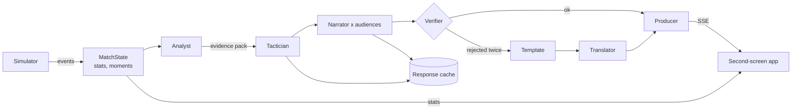

# Matchday Crew

A multi-agent AI broadcast crew that turns a live stream of synthetic football events into explainable, personalised match intelligence: on-screen overlays, a running story, player focus and a full-time recap, for an analyst or a casual fan, in their own language. Every line the AI writes is fact-checked against the match data before it airs.

Built for the Microsoft x Premier League **Inside the Game** developer hackathon.

> All data is synthetic. The clubs, players and matches are made up. No real league data, footage or branding is used.


## What it does

The hackathon asks for one pipeline with five stages. Here is where each one lives:

| Stage | What happens | Code |
|---|---|---|
| **Ingest** | A seeded simulator emits passes, carries, pressure, tackles, interceptions, shots, saves and goals with pitch coordinates, played out in accelerated real time | `src/engine/simulate.js`, `src/live/session.js` |
| **Interpret** | A live stats engine tracks possession, xG, pass accuracy and difficulty, progressive passes, PPDA, ball and shot speed, player stats, **momentum** and **chaos**, and detects key moments with the event IDs that prove them | `src/stats/matchState.js` |
| **Explain** | The Tactician agent says *why* a moment matters (control vs chaos, pressing, rhythm, game state) | `src/agents/crew.js` |
| **Render** | The Producer agent turns each moment into a timed, machine-readable overlay (type, position, duration, data); the web app draws it over the pitch | `src/agents/crew.js`, `public/` |
| **Personalise** | The Narrator rewrites every moment separately for an analyst and a casual fan, in the viewer's language, from their favourite club's side, with a player-focus mode and a follow-one-metric mode (xG, possession, pressing, pass difficulty, shot speed, sprint speed, momentum) | `src/agents/crew.js`, `src/stats/metrics.js`, `public/app.js` |

### The crew

| Agent | Kind | Job |
|---|---|---|
| Analyst | code | Watches every event, picks which moments are worth airing, builds an evidence pack |
| Tactician | model | Explains why the moment matters, citing event IDs |
| Narrator | model | Rewrites it per audience: persona, language, favourite club, favourite player, followed metric |
| Verifier | code | Rejects any line with a number, player or cited event not in the evidence; one retry with feedback, then a deterministic template |
| Translator | Azure AI Translator | Localises any template line so a non-English viewer never gets English |
| Producer | code | Builds the timed overlay for the rendering layer |
| Recap | model | Writes the full-time story for each audience |

They share one match state, hand work along a queue that never blocks the match clock, and recover from failures (rate limits, bad answers, outages) without the broadcast stopping. The app's *Behind the broadcast* panel shows every agent decision live.



## Run it

Needs Node 20.12 or newer. No npm dependencies.

```bash
npm start            # http://localhost:3000
npm test             # 43 tests
```

Pick a match, language, favourite club, player and a metric to follow, press **Kick off**, and switch between **Analyst** and **Casual fan** at any time. Deep links work for demos, e.g. `/?match=0&speed=60&language=Arabic&club=harbour&player=harbour-9&metric=xg&persona=casual&autostart=1`.

Without any configuration it runs offline: lines a model already wrote come from the response cache (`data/llm-cache/`), everything else from templates.

### Models

Copy `.env.example` to `.env` and fill in one provider:

| Provider | Settings | Notes |
|---|---|---|
| Microsoft Foundry | `FOUNDRY_ENDPOINT`, `FOUNDRY_DEPLOYMENT`, `FOUNDRY_API_KEY` | Azure OpenAI compatible deployment, e.g. gpt-4o-mini. Used first when set. Request format covered by contract tests |
| Groq (free tier) | `LLM_BASE_URL`, `LLM_MODEL`, `LLM_API_KEY` | Tested end to end with `openai/gpt-oss-120b` |
| Google Gemini, Ollama, any OpenAI-compatible API | same `LLM_*` settings | Gemini's free tier allows only 20 requests a day |
| Azure AI Translator | `AZURE_TRANSLATOR_KEY`, `AZURE_TRANSLATOR_REGION` | Free F0 tier |

Reasoning models (gpt-oss, Gemini) need `LLM_REASONING_EFFORT=low` and `LLM_MAX_TOKENS=1500`. Free tiers rate-limit; the client waits as long as the server asks and retries.

**Response cache.** Matches are seeded, so the same match for the same audience sends the same prompts. Answers are cached on disk by prompt hash, which makes replays instant and free, keeps the hosted demo inside free quotas, and lets the app serve real model output with no key at all.

### Other entry points

```bash
npm run crew                      # replay a match in the terminal
CREW_LANGUAGES=English,Arabic npm run crew
npm run generate 4                # write synthetic matches to data/
npm run mcp                       # MCP server (stdio)
```

**MCP server.** `scripts/mcp.js` exposes the match intelligence to any MCP client: `list_fixtures`, `match_summary`, `key_moments`, `player_stats` and `explain_moment` (the crew explains a moment for a persona and language, fact-checked). `.vscode/mcp.json` registers it for GitHub Copilot agent mode in VS Code.

## Deploy on Azure

`Dockerfile` builds a small Node image. CI (`.github/workflows/ci.yml`) runs the tests on Node 20 and 22, builds and smoke-tests the container, runs a headless browser check of the UI, and publishes the image to GitHub Container Registry on `main`. `infra/deploy.sh` deploys it to **Azure Container Apps** (scale to zero, keys as secrets), from Azure Cloud Shell or from the manual *Deploy to Azure* workflow.

Step by step, including exactly what to copy from the Azure portal: [docs/AZURE.md](docs/AZURE.md).

## Project layout

```
src/engine/     simulator and fictional clubs
src/stats/      live match state, stats and key-moment detection
src/agents/     the crew, evidence packs and verifier, templates
src/ai/         model client (Foundry or OpenAI-compatible), response cache, Azure Translator
src/live/       live session: paced events, crew queue, fixtures
src/server/     HTTP server and SSE stream
src/mcp/        MCP tools and stdio server
public/         second-screen web app (plain HTML, CSS, JS)
scripts/        start, crew runner, dataset generator, MCP, UI check
infra/          Azure Container Apps deploy script
data/           published synthetic matches and the response cache
test/           unit, contract (mock Foundry, OpenAI and Translator) and server tests
```

Hackathon requirements, test results and open work: [docs/HACKATHON.md](docs/HACKATHON.md).
