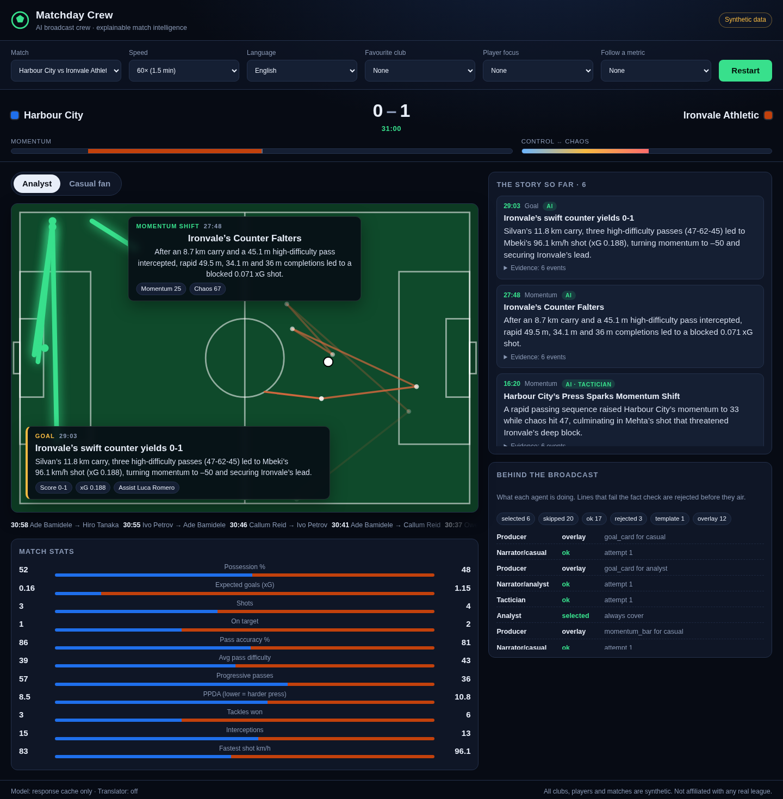
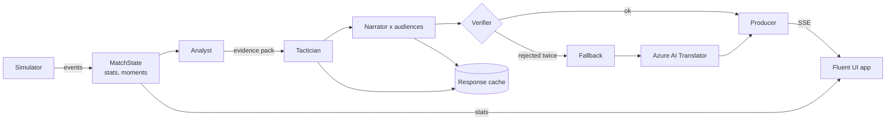

# Nutmeg Desk

A multi-agent AI broadcast crew that turns a live stream of synthetic football events into explainable, personalised match intelligence: on-screen overlays, a running story, player and metric focus and a full-time recap, for an analyst or a casual fan, in their own language. Every line the AI writes is fact-checked against the match data before it airs.

Built for the Microsoft x Premier League **Inside the Game** developer hackathon. Written in **TypeScript** end to end, with a **Fluent UI** second-screen app.

> All data is synthetic. The clubs, players and matches are made up. No real league data, footage or branding is used.



## What it does

The hackathon asks for one pipeline with five stages. Here is where each one lives:

| Stage | What happens | Code |
|---|---|---|
| **Ingest** | A seeded simulator emits passes, carries, pressure, tackles, interceptions, shots, saves and goals with pitch coordinates, played out in accelerated real time | `src/engine/simulate.ts`, `src/live/session.ts` |
| **Interpret** | A live stats engine tracks possession, xG, pass accuracy and difficulty, progressive passes, PPDA, ball and shot speed, player stats, **momentum** and **chaos**, and detects key moments with the event IDs that prove them | `src/stats/matchState.ts` |
| **Explain** | The Tactician agent says *why* a moment matters (control vs chaos, pressing, rhythm, game state) | `src/agents/crew.ts` |
| **Render** | The Producer agent turns each moment into a timed, machine-readable overlay (type, position, duration, data); the web app draws it over the pitch | `src/agents/crew.ts`, `web/src/components/Pitch.tsx` |
| **Personalise** | The Narrator rewrites every moment separately for an analyst and a casual fan, in the viewer's language, from their favourite club's side, with a player-focus mode and a follow-one-metric mode (xG, possession, pressing, pass difficulty, shot speed, sprint speed, momentum) | `src/agents/crew.ts`, `src/stats/metrics.ts`, `web/src` |

### The crew

| Agent | Kind | Job |
|---|---|---|
| Analyst | code | Watches every event, picks which moments are worth airing, builds an evidence pack |
| Tactician | model | Explains why the moment matters, citing event IDs |
| Narrator | model | Rewrites it per audience: persona, language, favourite club, favourite player, followed metric |
| Verifier | code | Rejects any line with a number, player or cited event not in the evidence; numbers with a unit (km/h, m, xG, %) must match a value of that kind; any player in the league counts; reads Arabic-Indic digits and decimal commas. One retry with feedback, then a fallback |
| Translator | Azure AI Translator | Localises any fallback line so a non-English viewer never gets English, and keeps it only if it still passes the fact check |
| Safety | Azure AI Content Safety | Screens every model-written line (hate, self-harm, sexual, violence) before it airs; flagged lines become templates |
| Producer | code | Builds the timed overlay for the rendering layer |
| Recap | model | Writes the full-time story for each audience |

They share one match state, hand work along a queue that never blocks the match clock, and recover from failures (rate limits, dropped connections, bad answers, outages) without the broadcast stopping. The app's *Behind the broadcast* panel shows every agent decision live.

How reliable is it? [docs/QUALITY.md](docs/QUALITY.md) measures it: share of lines written by the model, first-try and retry acceptance, rejection reasons, latency, and a tamper test that corrupts real model lines (shifted numbers, km for metres, invented players, fake citations) to see how many the fact checker catches.

### In the app

- **Players on the pitch**: everyone involved in recent play with shirt numbers in club colours, the ball at its carrier's feet with a name tag, the followed player ringed.
- **Analyst / casual fan** switch on the same live match, **16 languages**, favourite club, **player focus** and **follow-a-metric** modes.
- **Voice commentary**: every line read aloud with Azure AI Speech neural voices (browser voice when no key is set).
- **Broadcast view** (`/studio`): what a viewer at home sees: the live match full-screen with a scorebug and the crew's graphics, no controls. `voice=1` reads lines aloud. For broadcast software, `bg=transparent` keeps only the graphics (to layer in OBS or vMix over a video whose events come from the same data feed) and `bg=green` puts them on chroma green. The lines describe the synthetic match: the crew reads an event feed, it does not watch video.
- **First-visit tour**: new visitors are offered an interactive Fluent teaching-popover tour (or skip it); replay it any time from the header.
- **Evidence** under every line, and a live agent trace.



## Microsoft technologies

| Technology | Role |
|---|---|
| **TypeScript** | Whole codebase, strict mode. The server runs `.ts` directly on Node 22.18+ (type stripping), `tsc` type-checks everything in CI |
| **Fluent UI React v9** | Second-screen app: Microsoft's design system, light and dark themes |
| **Azure AI Translator** | Translator agent for any line that falls back to English |
| **Azure AI Speech** | Voice commentary with a neural voice per language |
| **Azure AI Content Safety** | Safety agent: every model-written line is screened before it airs |
| **Azure Application Insights** | Requests, every model and Azure AI call, a summary per match session, and errors (`src/telemetry.ts`, no SDK) |
| **Azure Container Apps** | Hosting: scale to zero, keys as secrets, health probes (`infra/deploy.sh`) |
| **Microsoft Foundry** | Compatible model provider: set three values and it is used first. Request format covered by contract tests |
| **GitHub Actions** | Type-check, tests on Node 22 and 24, web build, container build and smoke test, headless UI check, image publish |
| **GitHub Container Registry** | Free image hosting for the Azure deploy |
| **Model Context Protocol** | MCP server so GitHub Copilot agent mode can query matches and ask the crew to explain moments |
| **Agent2Agent (A2A)** | Agent card at `/.well-known/agent-card.json` and a JSON-RPC endpoint (`/a2a`) so other agents can call the crew's skills |

## Run it

Needs Node 22.18 or newer.

```bash
npm install          # TypeScript compiler (dev only; the server has no runtime dependencies)
npm run build        # build the Fluent UI app into web/dist
npm start            # http://localhost:3000
npm run check        # strict type-check of server and web app, then 57 tests
```

Pick a match, language, favourite club, player and a metric to follow, press **Kick off**, and switch between **Analyst** and **Casual fan** at any time. Deep links work for demos, e.g. `/?match=0&speed=60&language=Arabic&club=harbour&player=harbour-9&metric=xg&persona=casual&autostart=1`.

For UI work, `npm run dev` starts Vite with hot reload on port 5173 and proxies the API to `npm start`.

Without any configuration it runs offline: lines a model already wrote come from the response cache (`data/llm-cache/`), everything else from templates.

### Models

Copy `.env.example` to `.env` and fill in one provider:

| Provider | Settings | Notes |
|---|---|---|
| Microsoft Foundry | `FOUNDRY_ENDPOINT`, `FOUNDRY_DEPLOYMENT`, `FOUNDRY_API_KEY` | Azure OpenAI compatible deployment, e.g. gpt-4o-mini. Used first when set |
| Groq (free tier) | `LLM_BASE_URL`, `LLM_MODEL`, `LLM_API_KEY` | Tested end to end with `openai/gpt-oss-120b` |
| Google Gemini, Ollama, any OpenAI-compatible API | same `LLM_*` settings | Gemini's free tier allows only 20 requests a day |
| Azure AI Translator | `AZURE_TRANSLATOR_KEY`, `AZURE_TRANSLATOR_REGION` | Free F0 tier; tested live |

Reasoning models (gpt-oss, Gemini) need `LLM_REASONING_EFFORT=low` and `LLM_MAX_TOKENS=1500`. Free tiers rate-limit; the client waits as long as the server asks and retries, and backs off on dropped connections.

**Response cache.** Matches are seeded, so the same match for the same audience sends the same prompts. Answers are cached on disk by prompt hash, which makes replays instant and free, keeps the hosted demo inside free quotas, and lets the app serve real model output with no key at all. The demo match ships with model-written lines in English and Arabic.

### Other entry points

```bash
npm run crew                      # replay a match in the terminal
CREW_LANGUAGES=English,Arabic npm run crew
npm run generate 4                # write synthetic matches to data/
npm run mcp                       # MCP server (stdio)
npm run prewarm                   # pre-generate model lines for the published matches (resumable)
npm run quality                   # write docs/QUALITY.md
npm run ui-check -- "http://localhost:3000/?autostart=1&speed=60" out/ui 20   # headless UI check
```

**Production basics.** Application Insights telemetry, per-client rate limits on the live stream, speech and A2A endpoints, a strict Content-Security-Policy and other security headers, health probes, request size limits, and keys only in environment variables or Container Apps secrets.

**A2A.** Other agents discover the crew at `/.well-known/agent-card.json` and call `message/send` on `/a2a` with a data part such as `{"skill": "explain_moment", "arguments": {"seed": 7, "momentId": "m004", "persona": "casual", "language": "Arabic"}}`, or plain text.

**MCP server.** `scripts/mcp.ts` exposes the match intelligence to any MCP client: `list_fixtures`, `match_summary`, `key_moments`, `player_stats` and `explain_moment` (the crew explains a moment for a persona and language, fact-checked). Arguments are validated. `.vscode/mcp.json` registers it for GitHub Copilot agent mode in VS Code.

## Deploy on Azure

The `Dockerfile` builds the Fluent UI app in one stage and runs the TypeScript server on Node 22 in the next. CI publishes the image to GitHub Container Registry on `main`, and `infra/deploy.sh` deploys it to **Azure Container Apps** (scale to zero, keys as secrets), from Azure Cloud Shell or from the manual *Deploy to Azure* workflow.

Step by step, including exactly what to copy from the Azure portal: [docs/AZURE.md](docs/AZURE.md).

## Project layout

```
src/types.ts    shared domain types (server, tests and web app)
src/engine/     simulator and fictional clubs
src/stats/      live match state, stats, key moments, followed metrics
src/agents/     the crew, evidence packs and verifier, templates
src/ai/         model client (Foundry or OpenAI-compatible), response cache, Azure Translator, Azure Speech
src/live/       live session: paced events, crew queue, fixtures
src/server/     HTTP server and SSE stream
src/mcp/        MCP tools and stdio server
src/a2a/        Agent2Agent card and JSON-RPC endpoint
web/            Fluent UI React app (Vite, TypeScript)
scripts/        start, crew runner, dataset generator, MCP, pre-generation, quality report, UI check
infra/          Azure Container Apps deploy script
data/           published synthetic matches and the response cache
test/           unit, contract (mock Foundry, OpenAI and Translator) and server tests
```

Hackathon requirements and test results: [docs/HACKATHON.md](docs/HACKATHON.md). Plan to submission: [docs/ROADMAP.md](docs/ROADMAP.md).
